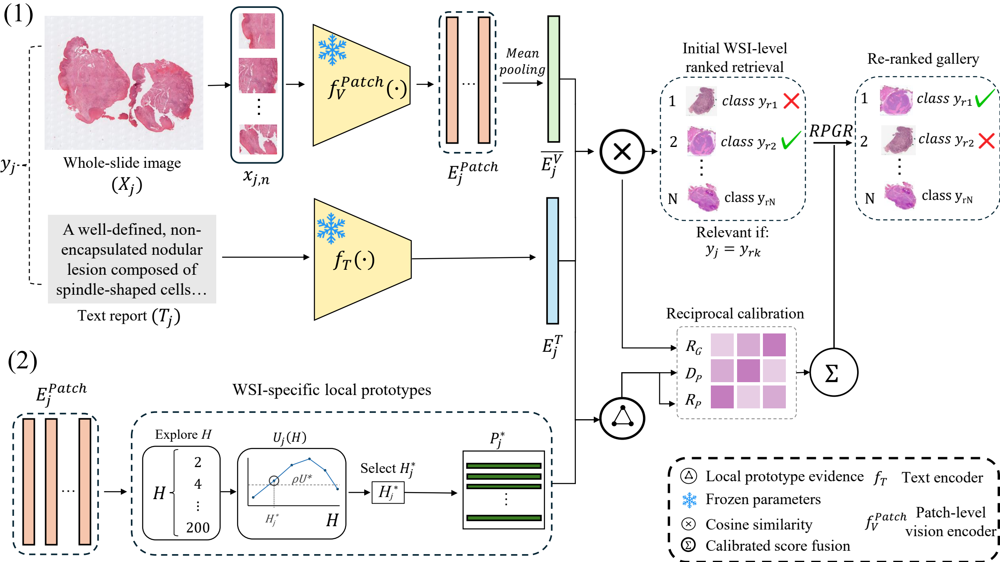

# RPGR: Reciprocal Prototype-Guided Re-ranking

Code for *Stress-Testing Vision–Language Pathology Foundation Models for WSI–Report Cross-Modal
Retrieval with Reciprocal Prototype-Guided Re-ranking*.

RPGR re-ranks whole-slide images and pathology reports on top of any frozen vision–language
pathology model. It needs no training, no labels and no tuning, and runs on CPU.



## Installation

```bash
git clone https://github.com/VictorRoAlb/RPGR-cross-modal-retrieval.git
cd RPGR-cross-modal-retrieval
python3.12 -m venv .venv && source .venv/bin/activate
pip install -r requirements.txt
```

## Use RPGR on your own embeddings

```python
import numpy as np
from rpgr import (AdaptiveSettings, build_adaptive_prototypes_for_case, global_similarity,
                  l2_normalize_rows, mean_pool, prototype_similarity, rpgr_score)

# patches[c]: (N_c, d) patch embeddings of WSI c;  reports: (n, d) report embeddings, same order as ids
wsi = np.stack([mean_pool(patches[c]) for c in ids]).astype(np.float64)
banks = [build_adaptive_prototypes_for_case(c, patches[c], AdaptiveSettings())["prototypes"].astype(np.float64) for c in ids]
text = l2_normalize_rows(reports.astype(np.float64))

S_G = global_similarity(wsi, text)            # WSIs x reports
S_P = prototype_similarity(banks, text)       # best-matching prototype of each WSI
image_to_text = rpgr_score(S_G, S_P)          # higher is better; one row per WSI query
text_to_image = rpgr_score(S_G.T, S_P.T)      # one row per report query
```

## Data

No data is distributed here. Copy `configs/paths.example.yaml` to `configs/paths.yaml` and set your
paths; file formats are described in `data/loaders.py`.

| Cohort | WSIs | Reports |
|---|---|---|
| TCGA | [GDC portal](https://portal.gdc.cancer.gov/) | `TCGA-Slide-Reports.csv.gz` from [TITAN](https://github.com/mahmoodlab/TITAN) |
| AI4SKIN | [figshare](https://doi.org/10.6084/m9.figshare.27118035) | on request, subject to institutional approval |

Patches of 512 × 512 pixels were extracted with
[CLAM](https://github.com/mahmoodlab/CLAM) and encoded with KEEP, CONCH, MUSK and PATHO-CLIP.
Report conditions, prompts and text encoders: [`text_conditions/`](text_conditions/README.md).

## Reproduce the paper

**1. Prepare** (once; repeat the last two for each encoder):

```bash
python -m data.tcga_cohort           --config configs/paths.yaml     # cohort and splits, Table A.1
python -m data.ai4skin_cohort        --config configs/paths.yaml     # fold checks, Table A.2
python -m data.build_pool_cache      --config configs/paths.yaml --backbone KEEP
python -m data.build_prototype_banks --config configs/paths.yaml --cohort tcga --backbone KEEP --n-jobs 16
```

For exact results, build the AI4SKIN banks (`--cohort ai4skin`) in a separate environment with
`requirements/prototypes_ai4skin.txt`: the paper's banks used scikit-learn 1.7.2 for TCGA and 1.9.0
for AI4SKIN, and mini-batch k-means differs between them. With 1.7.2, RPGR on AI4SKIN gives
0.467 / 0.470 mAP@10 (I2T / T2I) instead of 0.465 / 0.468.

**2. Run** (every command takes `--config configs/paths.yaml` and writes to `output_dir`):

| Result | Command |
|---|---|
| Table 1, Fig. 2 | `python -m experiments.stress_test`, `python -m figures.fig2_stress_test` |
| Fig. 3 | `python -m experiments.benchmark`, `python -m figures.fig3_benchmark` |
| Table 2 | `python -m experiments.gain_decomposition` |
| Section 5.5, inductive | `python -m experiments.inductive_evaluation` |
| Fig. 4 | `python -m experiments.qualitative_example`, `python -m figures.fetch_thumbnails`, `python -m figures.fig4_qualitative` |
| Table C.3 | `taskset -c 0 python -m experiments.compute_cost` |
| Fig. D.1 | `python -m figures.figD1_prototypes` |

The trained (TransMIL, SETMIL, DTN, FGCR) and slide-level (TITAN, PRISM) comparators of Fig. 3 are
evaluated from their exported test embeddings. Seeds, statistics and the tie-breaking protocol are
documented in each script.

**3. Check** the TCGA test values (KEEP, Morphology-only) to 1e-12:

```bash
RPGR_CONFIG=configs/paths.yaml pytest -q
```

## Repository

| Folder | Contents |
|---|---|
| `rpgr/` | the method, metrics and statistics |
| `baselines/` | compared methods |
| `data/` | loaders, cohorts, pooled vectors, prototype banks |
| `text_conditions/` | report preprocessing and text encoding |
| `experiments/`, `figures/` | one script per result |

## Citation

If you find our work useful in your research or use parts of this code, please consider citing our paper:

Rodríguez-Albendea, V. et al. Stress-Testing Vision–Language Pathology Foundation Models for
WSI–Report Cross-Modal Retrieval with Reciprocal Prototype-Guided Re-ranking. *Submitted to Medical
Image Analysis*, 2026.

```bibtex
@unpublished{Rodriguez-Albendea2026RPGR,
  title  = {Stress-Testing Vision--Language Pathology Foundation Models for WSI--Report Cross-Modal Retrieval with Reciprocal Prototype-Guided Re-ranking},
  author = {Rodríguez-Albendea, Víctor and Giménez-Devís, Cristóbal and Meseguer, Pablo and Terradez, Liria and Colomer, Adrián},
  note   = {Submitted to Medical Image Analysis},
  year   = {2026}
}
```

## License

MIT
